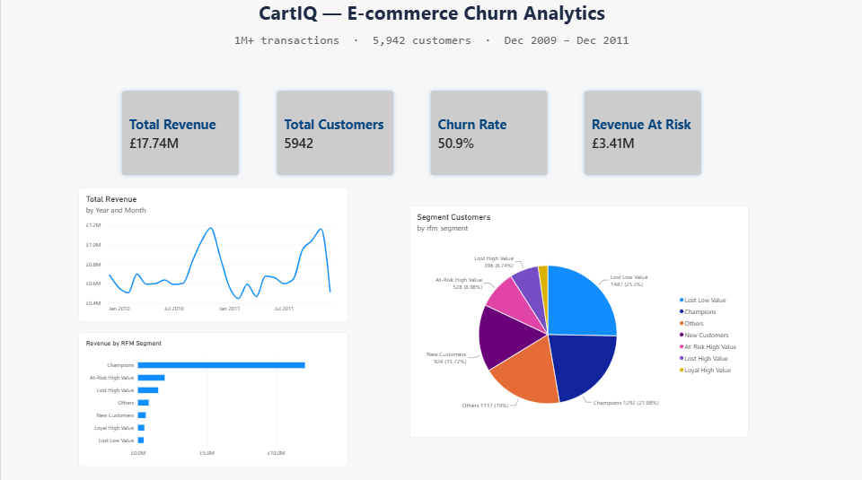
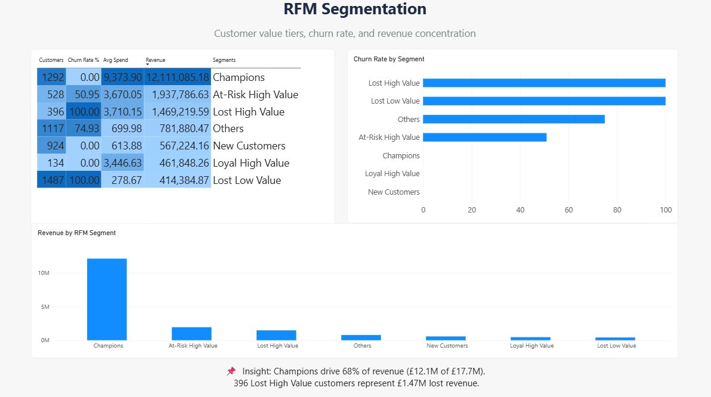
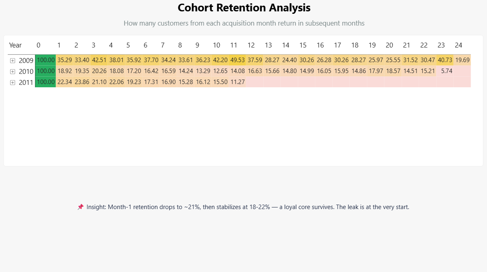
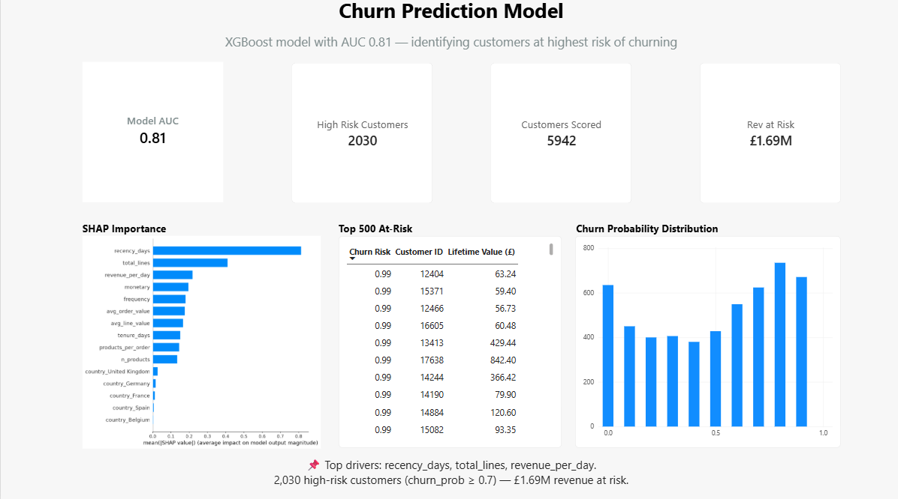

# 📊 CartIQ — E-commerce Churn Analytics Platform

An end-to-end **customer churn prediction and retention analytics platform** built on **1M+ real transactions** using **PostgreSQL, Python, XGBoost, SHAP, and Power BI**.

CartIQ answers one business question that every e-commerce company pays to solve:

> **"Which customers are about to churn, and where should we focus retention spend to protect revenue?"**

---

## 🎯 TL;DR

| Metric | Value |
|---|---|
| **Transactions analyzed** | 1,067,371 |
| **Customers scored** | 5,942 |
| **Revenue analyzed** | £17.74M |
| **Churn rate** | 50.9% |
| **Revenue at risk** | £3.41M |
| **Model AUC** | **0.81** |
| **High-risk customers flagged** | 2,030 |
| **Revenue from high-risk group** | £1.69M |

---

## 🖼️ Dashboard Preview

### 1. Executive Summary


### 2. RFM Segmentation


### 3. Cohort Retention


### 4. Churn Prediction Model


---

## 🔍 Key Business Findings

### 1. Revenue is dangerously concentrated
- **Champions (22% of customers)** generate **68% of revenue** (£12.1M of £17.7M)
- Losing even 10% of Champions = **£1.2M annual loss**
- Classic Pareto: top customers fund the business

### 2. High-value customers are quietly churning
- **396 "Lost High Value" customers** = 100% churned — **£1.47M already gone**
- **528 "At-Risk High Value"** = 51% churn rate — **£1.94M on the edge**
- These are the customers who *used to* spend £3,000+ but stopped

### 3. The retention leak is at month 1
- **Month-1 retention drops to 21%**
- Then **stabilizes at 18-22%** through month 6
- Implication: retention efforts should target **new customers in their first 30 days**

### 4. Churn is predictable
- **XGBoost model: AUC 0.81** using only pre-cutoff behavior (no data leakage)
- Top churn drivers (via SHAP):
  - **recency_days** — days since last purchase
  - **total_lines** — total items bought
  - **revenue_per_day** — spend velocity
  - **monetary** — lifetime value
  - **frequency** — number of orders

### 5. Actionable target list produced
- **2,030 customers** flagged with churn probability ≥ 0.7
- **£1.69M revenue** represented by this cohort
- Top 500 exported as CSV for CRM retention campaigns

---

## 💡 Business Recommendations

### Short-term (0-30 days)
- **Launch win-back campaign** for 528 At-Risk High Value customers
  - Target: £500K recovery in 90 days
  - Channel: personalized email + discount voucher
- **Deploy retention nudges** for 2,030 high-risk customers
  - Use churn_prob scores to prioritize outreach

### Medium-term (1-6 months)
- **Build month-1 onboarding program**
  - Focus on converting first-time buyers within 30 days
  - Expected impact: +5% retention = **£800K annual revenue**
- **Flag churn risk in CRM** — integrate `churn_prob` scores into Salesforce/HubSpot

### Long-term (6-12 months)
- **Retrain model monthly** on fresh data
- **Add uplift modeling** — predict who *responds* to retention offers (not just who churns)
- **Implement real-time scoring** for new customers

---

## 🏗️ Architecture

```
┌────────────────────────────────────────────────────────────┐
│  1. SOURCE                                                  │
│     UCI Online Retail II (1M+ transactions)                 │
└──────────────────────┬─────────────────────────────────────┘
                       ▼
┌────────────────────────────────────────────────────────────┐
│  2. STAGING (PostgreSQL)                                    │
│     staging.retail — raw, untyped                           │
└──────────────────────┬─────────────────────────────────────┘
                       ▼
┌────────────────────────────────────────────────────────────┐
│  3. STAR SCHEMA (PostgreSQL analytics schema)               │
│     dim_customer · dim_product · dim_date                   │
│     fact_sales (824,364 clean transactions)                 │
└──────────────────────┬─────────────────────────────────────┘
                       ▼
┌────────────────────────────────────────────────────────────┐
│  4. ANALYSIS LAYER (SQL)                                    │
│     rfm_scores · rfm_segments · cohort_retention            │
│     churn_drivers                                           │
└──────────────────────┬─────────────────────────────────────┘
                       ▼
┌────────────────────────────────────────────────────────────┐
│  5. ML LAYER (Python)                                       │
│     XGBoost (AUC 0.81) + SHAP explainability                │
│     Writes churn_prob back to dim_customer                  │
└──────────────────────┬─────────────────────────────────────┘
                       ▼
┌────────────────────────────────────────────────────────────┐
│  6. BI LAYER (Power BI)                                     │
│     4-page interactive dashboard + executive memo           │
└────────────────────────────────────────────────────────────┘
```

---

## 🛠️ Tech Stack

| Layer | Tools |
|---|---|
| **Database** | PostgreSQL 16 |
| **Languages** | Python 3.12, SQL |
| **Python libs** | pandas, SQLAlchemy, XGBoost, scikit-learn, SHAP, matplotlib |
| **BI** | Power BI Desktop |
| **Version control** | Git + GitHub |
| **Environment** | Windows PowerShell + Python venv |

---

## 🧠 Methodology

### 1. Data Cleaning
- Handled 1M+ rows with real-world messiness
- Removed cancellations (negative quantities, invoice starting with 'C')
- Filtered guest purchases (NULL customer_id)
- Removed non-product stock codes (TEST, ADJUST, POST)
- Standardized country names and product categories

### 2. Star Schema Design
- **3 dimensions:** customer, product, date
- **1 fact table:** fact_sales (824K clean transactions)
- Indexed for fast Power BI queries

### 3. RFM Segmentation
- **Recency:** days since last purchase
- **Frequency:** number of distinct invoices
- **Monetary:** total revenue per customer
- Scored 1-5 on each dimension using `NTILE(5)`
- Segmented into 7 tiers: Champions, Loyal HV, New, At-Risk HV, Lost HV, Lost LV, Others

### 4. Cohort Retention
- Grouped customers by first-purchase month
- Tracked repurchase behavior for 24 months forward
- Revealed month-1 drop + stabilization pattern

### 5. ML Pipeline (Time-Based, No Leakage)
- **Cutoff date:** 2011-09-09 (90 days before dataset end)
- **Features:** customer behavior *before* cutoff
- **Label:** did customer purchase *after* cutoff?
- **Model:** XGBoost with `scale_pos_weight` for class imbalance
- **Explainability:** SHAP values for feature importance

---

## 📊 Model Performance

| Metric | Value |
|---|---|
| **AUC-ROC** | **0.8082** |
| PR-AUC | 0.8238 |
| Precision | 0.7609 |
| Recall | 0.7903 |
| F1 Score | 0.7753 |
| Training rows | 4,222 |
| Test rows | 1,056 |

**Why this matters:** AUC 0.81 means the model correctly ranks 81% of churning vs. non-churning customers. Well above random (0.5) and above the typical industry threshold for "useful" (0.75).

---

## 📁 Project Structure

```
cartiq/
├── data/
│   ├── raw/                    # Raw CSVs from UCI
│   └── processed/
├── sql/
│   ├── 01_schema.sql           # Star schema DDL
│   ├── 02_load_staging.sql     # COPY commands
│   ├── 03_etl_dim_fact.sql     # ETL to star schema
│   └── 04_rfm_cohorts.sql      # RFM + cohorts + churn signal
├── src/
│   ├── convert_to_csv.py       # xlsx → csv
│   ├── model.py                # XGBoost + SHAP
│   └── artifacts/
│       └── churn_model.pkl     # Trained model
├── dashboards/
│   ├── CartIQ.pbix             # Power BI file
│   └── screenshots/            # PNG exports
├── reports/
│   ├── shap_importance.png
│   ├── shap_beeswarm.png
│   ├── top_500_at_risk_customers.csv
│   └── executive_memo.pdf
├── requirements.txt
├── docker-compose.yml
└── README.md
```

---

## ⚙️ How to Run

### 1. Clone the repository
```bash
git clone https://github.com/aditiyaank/cartiq.git
cd cartiq
```

### 2. Set up Python environment
```bash
python -m venv venv
venv\Scripts\activate          # Windows
# source venv/bin/activate     # Mac/Linux
pip install -r requirements.txt
```

### 3. Download the dataset
- Get `online_retail_II.xlsx` from [UCI ML Repository](https://archive.ics.uci.edu/dataset/502/online+retail+ii)
- Place in `data/raw/`

### 4. Convert Excel to CSV
```bash
python src/convert_to_csv.py
```

### 5. Create PostgreSQL database
```bash
createdb cartiq
psql -U postgres -d cartiq -f sql/01_schema.sql
psql -U postgres -d cartiq -f sql/02_load_staging.sql
psql -U postgres -d cartiq -f sql/03_etl_dim_fact.sql
psql -U postgres -d cartiq -f sql/04_rfm_cohorts.sql
```

### 6. Train the churn model
```bash
# Edit DB_URL in src/model.py with your Postgres password
python src/model.py
```

### 7. Open the dashboard
- Open `dashboards/CartIQ.pbix` in Power BI Desktop
- Refresh data connections

---

## 🎓 Skills Demonstrated

### SQL
- Star schema design (fact + dim modeling)
- Window functions (`NTILE`, `ROW_NUMBER`, `PARTITION BY`)
- CTEs for multi-step transformations
- Cohort analysis with `DATE_TRUNC`, `AGE`
- Query optimization with indexes

### Python
- pandas for ETL and feature engineering
- SQLAlchemy for Postgres integration
- XGBoost for gradient-boosted churn prediction
- SHAP for model explainability
- Time-based train/test split (no leakage)

### Power BI
- Data modeling with relationships
- 12+ custom DAX measures
- Multi-page dashboard design
- Conditional formatting (heatmaps)
- Interactive cross-filtering

### Business
- Framing a churn problem as a business question
- RFM segmentation (a classic CRM technique)
- Translating model outputs into CRM actions
- Executive communication (memo format)

---

## 🎤 Resume Bullets

> **Built CartIQ**, an end-to-end e-commerce churn analytics platform ingesting 1M+ transactions from UCI Online Retail II into a PostgreSQL star schema; performed RFM segmentation and cohort retention analysis on 5,942 customers.

> Developed a time-based XGBoost churn model (AUC 0.81, PR-AUC 0.82) using pre-cutoff behavior to predict future churn, with SHAP explainability identifying recency_days, total_lines, and revenue_per_day as top drivers.

> Surfaced £3.41M revenue at risk from At-Risk and Lost High Value customers; produced a prioritized list of top 500 at-risk customers for retention teams and an executive memo recommending CRM interventions.

---

## 🔮 Future Enhancements

- **Uplift modeling** — predict which customers respond to retention offers (not just who churns)
- **Survival analysis** — Cox proportional hazards to predict *when* each customer will churn
- **FastAPI deployment** — expose model as REST endpoint
- **Real-time scoring** — auto-score new customers on signup
- **A/B test simulation** — model retention campaign impact

---

## 👨‍💻 Author

**aditiyaank**
B.Tech Computer Science & Engineering

**Interests:** Data Analytics · Data Engineering · Business Intelligence · Data Science

---

⭐ If you found this project useful, give it a star!
